# Software Design — Smart Campus Second-hand Trading Platform

Week 2 deliverable: system structure, database entities, UML models and the frozen
interfaces between Pair A and Pair B.

| Item | Value |
| --- | --- |
| Course | Software Engineering (MUST), Group 11 — SeekDeep |
| Week | Week 2 — "Design the main system structure, database entities and required UML diagrams" |
| Date | 2026-11-10 |
| Baseline | Task1 proposal (2026/10/7) + Task2 URS `REQ-1.1 … REQ-8.1` (2026/10/18) |
| Reference implementation | v1.0, tag `v1.0` (2026-11-05) |
| Diagram sources | `docs/design/*.mmd` (Mermaid) |
| Rendered figures | `docs/design/render/*.svg` and `*.png` (for the Word report) |

The diagrams are written twice on purpose: the Mermaid sources render directly on GitHub, and
the rendered PNG files can be pasted into the report. Appendix A explains how to regenerate them
after a design change.

---

## 1. Scope of this document

Week 2 closes two backlog items:

| Item | Deliverable in this document |
| --- | --- |
| A5 | Architecture diagram, UML use case diagram, UML class diagram, ER diagram, two UML sequence diagrams, one activity diagram |
| A6 | Frozen interface contracts between Pair A (F1, F2, F3, F6) and Pair B (F4, F5, F7, F8) |

The design is written against the implemented v1.0 code, so every element below can be checked
against a real file. Where the design deliberately differs from the URS, the deviation is listed
in Section 9 instead of being hidden.

## 2. System structure

Three layers, one deployment unit: a Spring Boot application that serves both the JSON API and
the static frontend, so the demo needs nothing but a JDK.

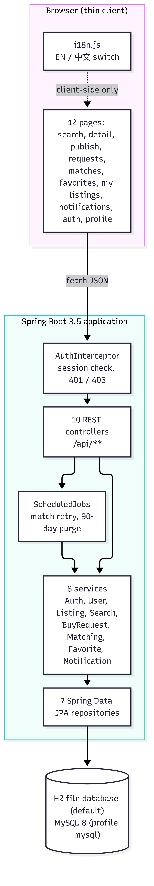

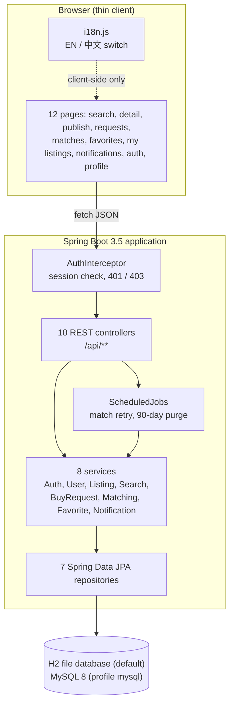

| Layer | Responsibility | Rule |
| --- | --- | --- |
| Browser | Rendering, form validation, language switch | Holds no business rule; every rule is re-checked on the server |
| Controller | URL mapping, session extraction, envelope | Never touches a repository directly |
| Service | Business rules, transactions, cross-service calls | One service owns one feature group (F1–F8) |
| Repository | Persistence only | No business decision inside a query method |
| ScheduledJobs | Safety nets: matching retry, notification purge | Never the only path to a feature |

## 3. Domain model (UML class diagram)

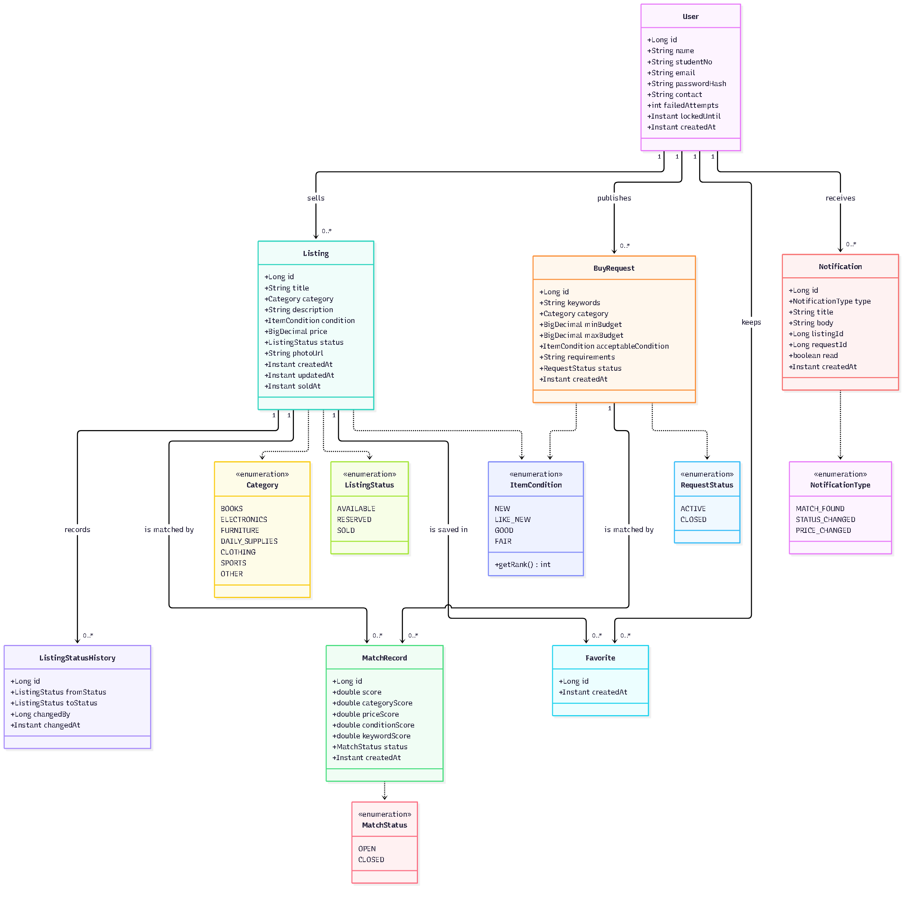

Seven entities and six enumerations; the matching engine depends only on `Listing`,
`BuyRequest` and `ItemCondition`.

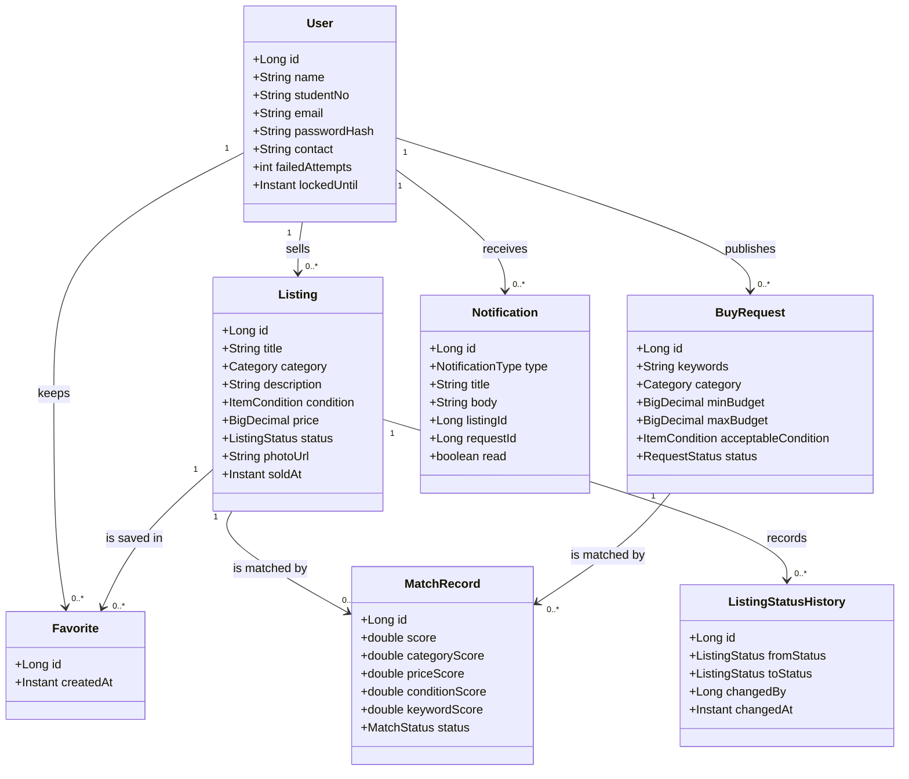

### 3.1 Entity responsibilities and invariants

| Entity | Owner | Invariants enforced in code |
| --- | --- | --- |
| `User` | Pair A (F1) | `studentNo` and `email` unique; password stored as salted BCrypt hash; 5 consecutive failures lock the account for 10 minutes; session lasts 2 hours |
| `Listing` | Pair A (F2) | Price > 0; at most 50 active (`AVAILABLE` + `RESERVED`) listings per seller; editable only while `AVAILABLE`; deletion cascades to favourites, matches and history |
| `BuyRequest` | Pair B (F4) | `minBudget <= maxBudget`; at most 20 active requests per buyer; closing a request closes its open matches |
| `Favorite` | Pair A (F6) | Unique pair (`user_id`, `listing_id`); at most 200 favourites per user; saving twice is a no-op |
| `MatchRecord` | Pair B (F5) | Unique pair (`listing_id`, `request_id`); score and four sub-scores stored, never recomputed at read time; `OPEN` only while the pair still qualifies |
| `ListingStatusHistory` | Pair B (F7) | Append-only; one row per accepted transition with actor id and timestamp |
| `Notification` | Pair B (F8) | Related listing and request kept as ids, not foreign keys, so a notification survives listing deletion; purged after 90 days |

### 3.2 State model

`Listing.status`: `AVAILABLE → RESERVED → SOLD`, plus `RESERVED → AVAILABLE`.
`SOLD → AVAILABLE` is refused by design ("not allowed in version 1"), because a sold item that
returns to the market would silently invalidate the transaction history of the first sale.

`BuyRequest.status`: `ACTIVE → CLOSED` (one way).
`MatchRecord.status`: `OPEN ⇄ CLOSED` — a record reopens when the pair qualifies again, which
happens when a reserved listing returns to `AVAILABLE` or a listing price is edited down.

## 4. Data design (ER diagram)

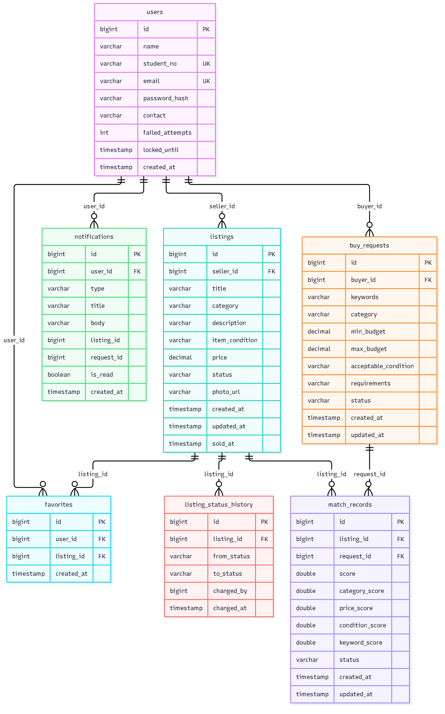

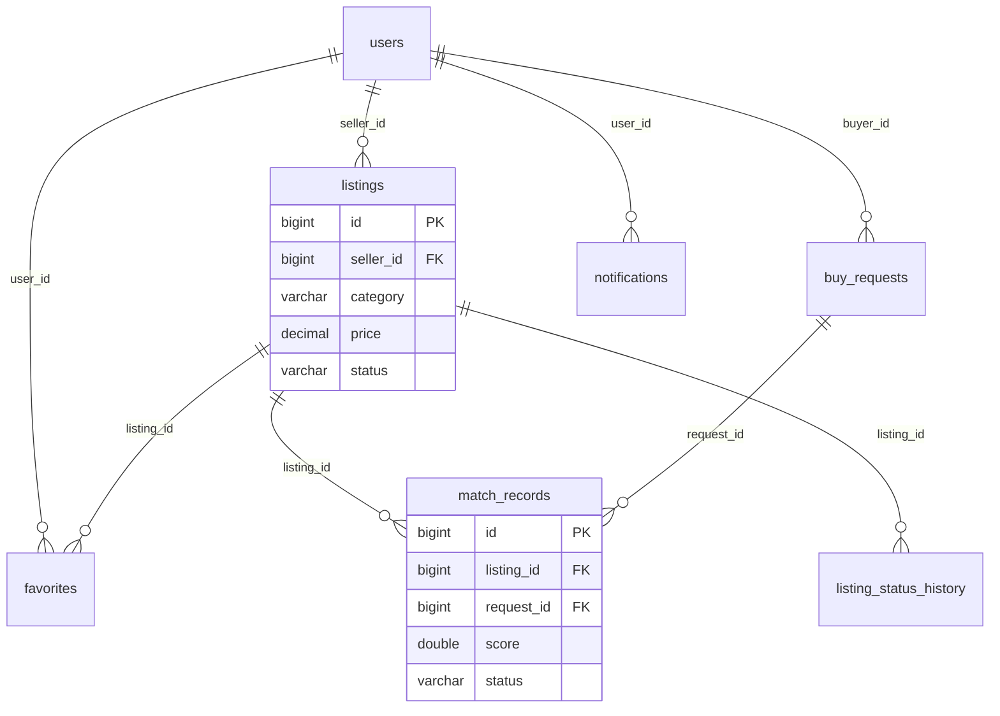

| Design point | Decision |
| --- | --- |
| Primary keys | Surrogate `BIGINT IDENTITY`, never natural keys, so a student number can be corrected without touching child rows |
| Unique constraints | `users.student_no`, `users.email`, `favorites(user_id, listing_id)`, `match_records(listing_id, request_id)` |
| Indexes | Every foreign key, plus the columns the search and matching filters use: `listings(status, category, price)`, `buy_requests(status, category)`, `match_records(score)` |
| Money | `DECIMAL(10,2)` (MOP), never floating point |
| Time | `Instant` / `TIMESTAMP`, UTC in the database, formatted per browser locale in the UI |
| Deletion | User-triggered listing deletion removes children explicitly; account deletion anonymises instead of dropping rows, so other users' history stays readable |

## 5. Matching rule (activity + weights)

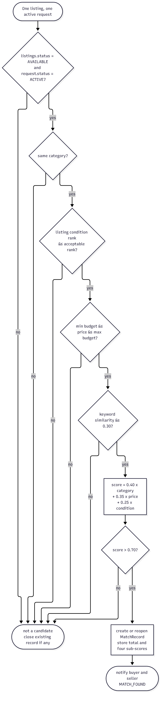

Five hard gates first, then a weighted score; a pair is stored only when it survives both.

| Gate | Rejected when |
| --- | --- |
| State | Listing is not `AVAILABLE` or request is not `ACTIVE` |
| Category | Categories differ (compared before any scoring, so it is a filter, not a weight) |
| Condition | `listing.condition.rank > request.acceptableCondition.rank` |
| Budget | `price < minBudget` or `price > maxBudget` |
| Keywords | Similarity < 0.30 |

```
score = 0.40 × category + 0.35 × price + 0.25 × condition      stored when score > 0.70
```

| Condition gap (accepted rank − listing rank) | Condition score |
| --- | --- |
| 0 (exactly what the buyer asked for) | 1.00 |
| 1 | 0.75 |
| 2 | 0.50 |
| 3 or more | 0.25 |

Keyword similarity is **coverage of the buyer's keywords (0.75) + precision in the listing text
(0.25)**, not a symmetric text distance: the buyer asks "does this listing contain what I want",
so a long description must not dilute a good match. Decision D10 in `PROJECT_LOG.md` records the
reasoning.

Worked example — listing "24 inch monitor HDMI like new, MOP 800" against request
"24 inch monitor hdmi", budget 500–900, accepts `GOOD`:

| Term | Value | Contribution |
| --- | --- | --- |
| Category | same | 0.40 |
| Price | 800 inside 500–900 | 0.35 |
| Condition | `LIKE_NEW` (1) vs accepted `GOOD` (2), gap 1 | 0.25 × 0.75 = 0.1875 |
| **Total** | | **0.94** → stored, both users notified |

Because category and price always contribute their full weight once the gates have passed, the
visible score range is roughly **0.81–1.00**. That is stated on the Matches page instead of being
hidden, so a shown score can be checked by hand.

## 6. Interaction design

### 6.1 Publish a listing and run matching

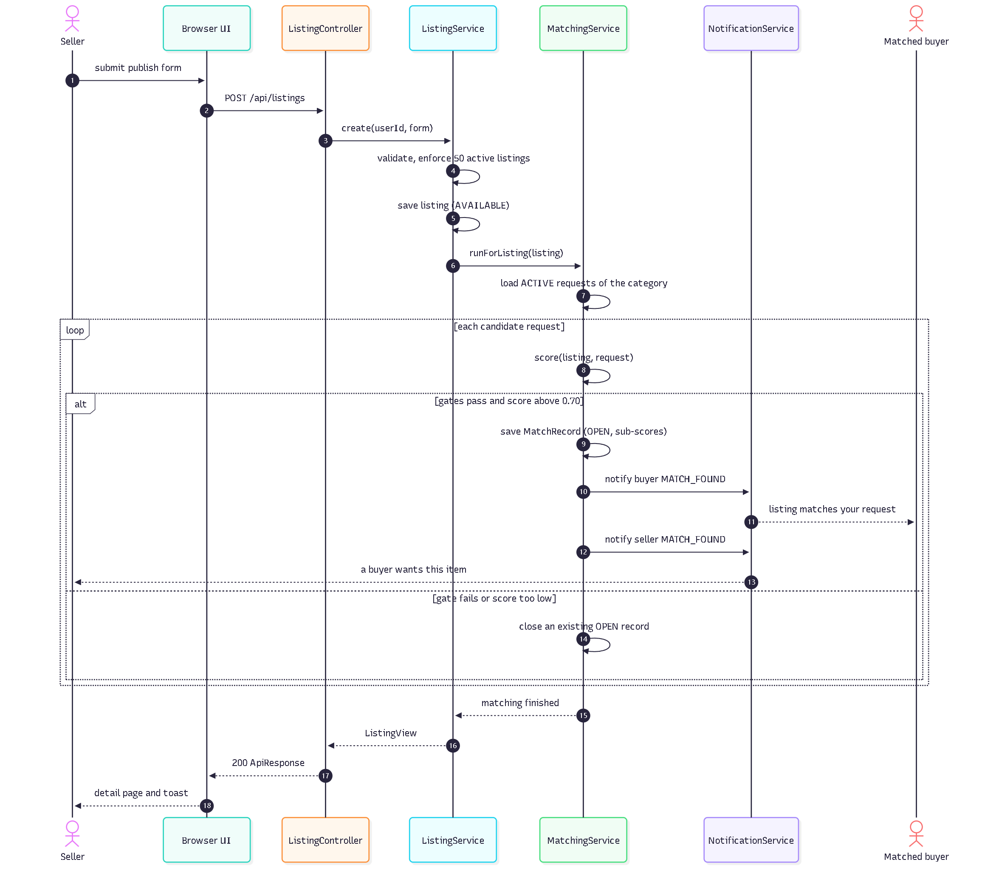

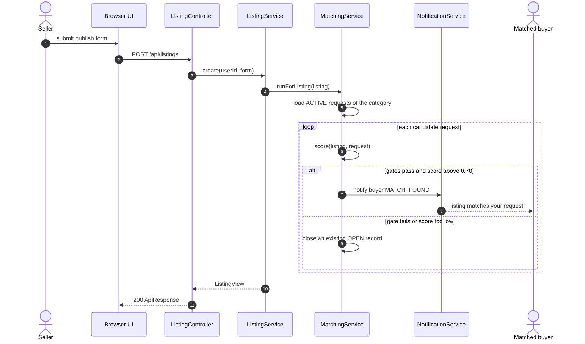

Key point: matching runs **inside the publishing transaction**. If persisting the listing fails,
no match and no notification exists; the buyer is never told about an item that was not saved.

### 6.2 Change the transaction status

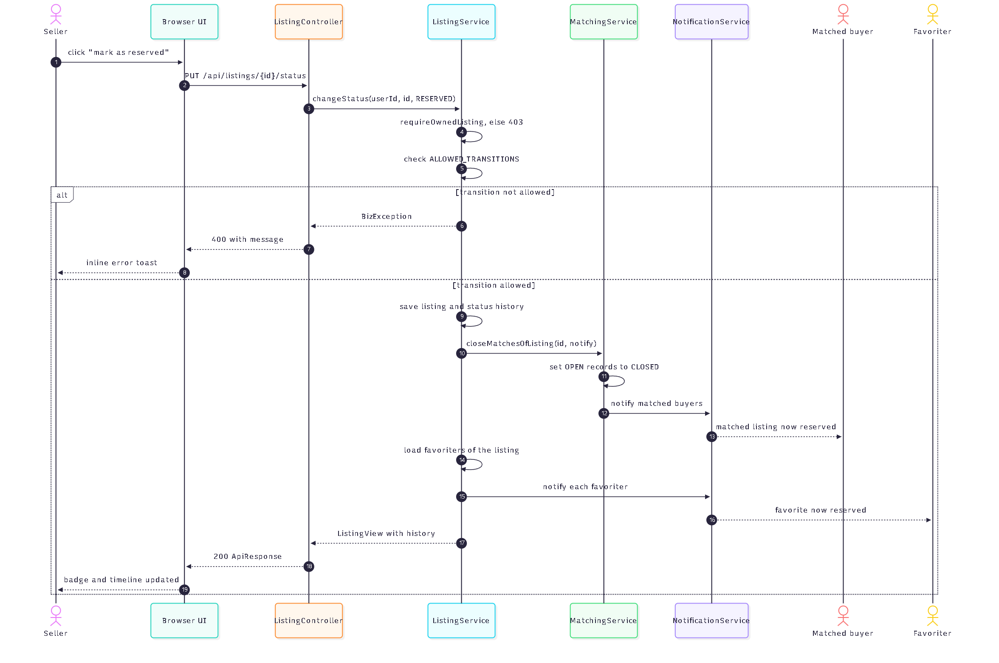

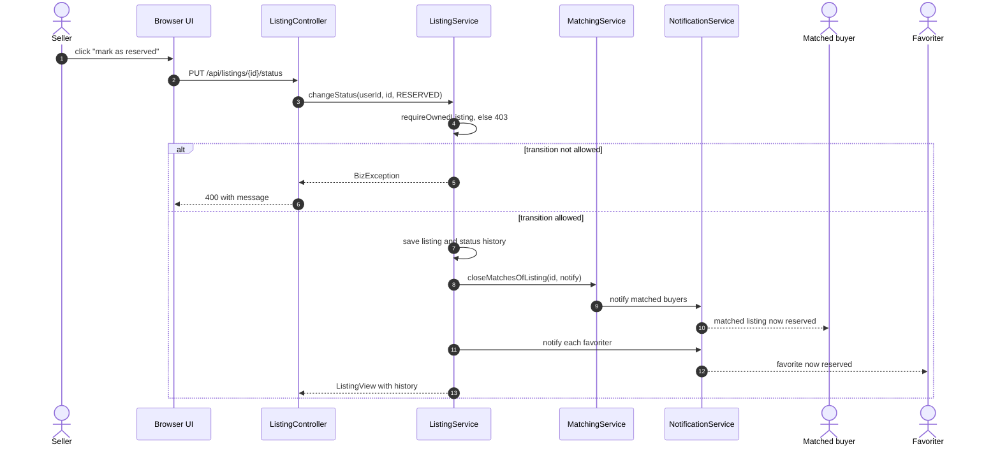

Two notification audiences are served from one transition: buyers who were matched (they lost
their match) and users who favourited the item (the item they watch changed). Both are part of
`F7`, not of `F8`: `F8` only stores and displays what `F5` and `F7` decide to send.

## 7. Use case model and traceability

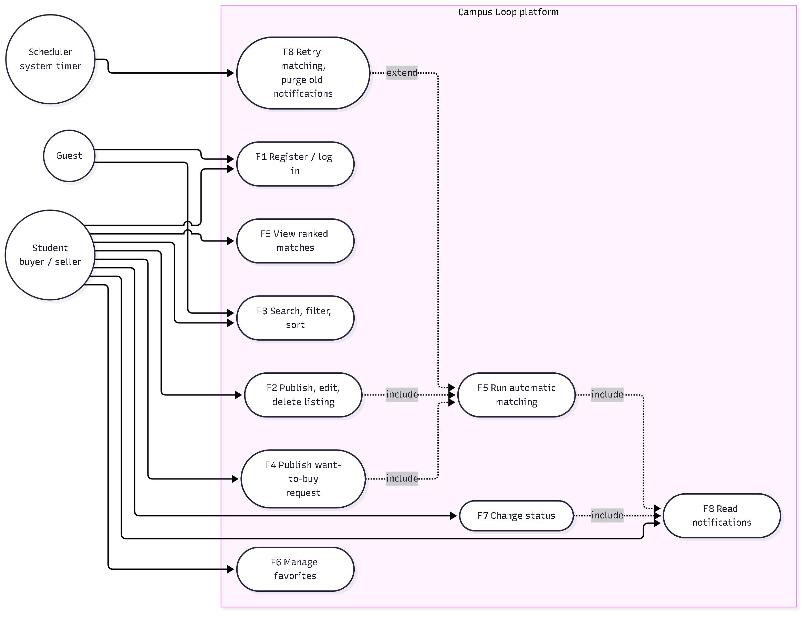

| Actor | Description |
| --- | --- |
| Guest | Not logged in; may register, log in, search and read a listing detail |
| Student | One role with two hats — buys and sells with the same account, as in the URS |
| Scheduler | System timer, not a person: retries matching and purges old notifications |

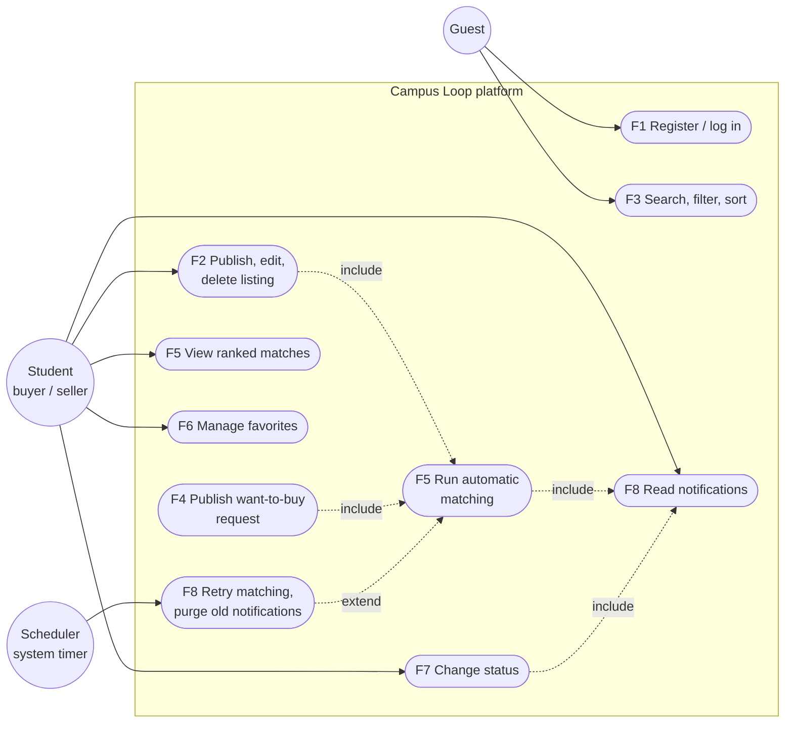

### 7.1 Traceability from requirements to code

| Feature | REQ | Use case | Service | REST endpoint | Owner |
| --- | --- | --- | --- | --- | --- |
| F1 Accounts | REQ-1.1 | Register / log in | `AuthService`, `UserService` | `/api/auth/*`, `/api/me` | Wu Yutong |
| F2 Listings | REQ-2.1 | Publish, edit, delete | `ListingService` | `/api/listings` | Wu Yutong |
| F3 Search | REQ-3.1 | Search, filter, sort | `SearchService` | `GET /api/search` | Wang Yike |
| F4 Want-to-buy | REQ-4.1 | Publish request | `BuyRequestService` | `/api/requests` | Chen Moxiong |
| F5 Matching | REQ-5.1 | Run / view matching | `MatchingService`, `TextSimilarity` | `GET /api/matches` | Chen Moxiong |
| F6 Favorites | REQ-6.1 | Manage favorites | `FavoriteService` | `/api/favorites` | Wang Yike |
| F7 Status | REQ-7.1 | Change status | `ListingService.changeStatus` | `PUT /api/listings/{id}/status` | Gao Shengzhe |
| F8 Notifications | REQ-8.1 | Read notifications | `NotificationService`, `ScheduledJobs` | `/api/notifications` | Gao Shengzhe |

Automated coverage today is limited to the two classes with real logic to test —
`MatchingServiceTest` (8 cases) and `TextSimilarityTest` (6 cases), 14 in total. The remaining
features are covered by the API smoke checks listed in `docs/RELEASE_v1.0.md` Section 3; moving
those checks into JUnit tests is part of Week 7.

## 8. Frozen interfaces between Pair A and Pair B (A6)

The two pairs implement different features in the same application, so the four calls that cross
the pair boundary are frozen here. **Changing any signature, return type or error behaviour below
requires agreement from both pairs and an entry in `PROJECT_LOG.md`.**

### 8.1 Response envelope (applies to every call)

```json
{ "success": true, "message": null, "data": { } }
```

Errors return `success: false`, a human-readable English `message`, and an HTTP status
(`400` validation or rule violation, `401` not logged in, `403` not the owner, `404` not found,
`409` duplicate). `GlobalExceptionHandler` performs the mapping; services only throw `BizException`.

### 8.2 `search` — provided by Pair A (F3), used by the browse page

```java
PageResult<ListingView> search(String keyword, Category category,
                               BigDecimal minPrice, BigDecimal maxPrice,
                               List<ItemCondition> conditions,
                               String sort, int page, int size)
```

| Aspect | Frozen behaviour |
| --- | --- |
| Visibility | Only `AVAILABLE` listings; `RESERVED` and `SOLD` never returned |
| Keyword | Case-insensitive substring over title **and** description |
| Sort | `newest` (default), `price_asc`, `price_desc`; unknown value falls back to `newest` |
| Paging | Default size 20, maximum 60; `page` below 0 is clamped to 0 |
| Errors | `400` when `minPrice > maxPrice` |
| Response | `items[], page, size, total, totalPages` |

### 8.3 `priceStats` — reserved contract (F3 scope, no consumer in v1)

```java
PriceStats priceStats(Category category)              // record PriceStats(long count, BigDecimal min, BigDecimal max, BigDecimal average)
GET /api/search/price-stats?category=ELECTRONICS
```

Agreed so that Pair B can add a "is my price fair?" hint to the want-to-buy form in v1.1 without
touching Pair A's code later. **Status: frozen, not implemented in v1.0** — no v1.0 screen shows
price statistics, so implementing it now would be dead code. Statistics use `AVAILABLE` listings
only and return `count = 0` with `null` min/max/average for an empty category.

### 8.4 `findMatches` — provided by Pair B (F5), called by Pair A after every write

```java
void runForListing(Listing listing)                       // after create / edit / re-open of a listing
void runForRequest(BuyRequest request)                    // after create / edit of a request
void closeMatchesOfListing(Long listingId, boolean notifyBuyers)
List<MatchView> matchesForUser(Long userId)               // GET /api/matches
Optional<PairScore> score(Listing listing, BuyRequest request)
```

| Aspect | Frozen behaviour |
| --- | --- |
| When Pair A must call it | Exactly once per successful write, inside the same transaction, after the entity is saved |
| Idempotency | Re-running is safe: a pair is upserted by (`listing_id`, `request_id`), never duplicated |
| Threshold | `score > 0.70`; a pair below it is not stored and an existing `OPEN` record is closed |
| Side effect | A newly created match notifies **both** users (`MATCH_FOUND`) |
| Reads | `matchesForUser` returns only `OPEN` records where the viewer is the seller or the buyer, newest score first |

### 8.5 `notify` — provided by Pair B (F8), called by F5, F6 and F7

```java
void notifyUser(Long userId, NotificationType type, String title, String body,
                Long listingId, Long requestId)
```

| Aspect | Frozen behaviour |
| --- | --- |
| Types | `MATCH_FOUND`, `STATUS_CHANGED`, `PRICE_CHANGED` — anything else is a design error |
| Length | `title` ≤ 120 characters, `body` ≤ 300 characters (column limits) |
| Transaction | Runs in `REQUIRES_NEW`: a notification failure must never roll back the business action |
| Failure | Retried once, then logged and abandoned; `notifyUser` never throws to the caller |
| Language | English body, stored as final text; the client translates labels but not bodies (known limitation, A11) |
| Ids | `listingId` / `requestId` are plain ids, so the notification stays readable after the listing is deleted |

## 9. Design decisions and deviations

| # | Decision | Reason | Deviation from URS? |
| --- | --- | --- | --- |
| DD-1 | Three layers in one deployable jar | One-command demo, no build step for the frontend | No |
| DD-2 | Category is a hard filter, not a weight | A matching book for a laptop request is never useful | Interpretation of REQ-5.1, documented on the Matches page |
| DD-3 | Keyword similarity = coverage + precision | Matches the buyer's question; robust against long descriptions | URS only says "above a threshold" |
| DD-4 | Matching inside the caller's transaction, notifications in their own | Data stays consistent; a mail/notification error cannot lose a listing | No |
| DD-5 | `SOLD → AVAILABLE` refused | Protects the transaction history of a completed sale | Narrower than REQ-7.1 allows |
| DD-6 | Default database is file-based H2, MySQL 8 via profile | The demo machine has no database server; the MySQL profile satisfies the written requirement | Yes — decision D9, must be stated in the report |
| DD-7 | Translation lives in the browser (`i18n.js`) | API contract stays language-neutral; no second deployment | No (English labels remain the default) |

## 10. Open design items after Week 2

| # | Item | Owner | Target |
| --- | --- | --- | --- |
| D1 | Turn the API smoke checks into JUnit tests (controllers + services) | whole team | Week 7 |
| D2 | Measurement record for Success Criteria 1–5 | whole team | Week 7 |
| D3 | `priceStats` implementation, if a v1.1 screen consumes it | Wang Yike | v1.1 |
| D4 | Pagination on Matches and Notifications pages | Gao Shengzhe | v1.1 |
| D5 | Photo upload (multipart) instead of a photo URL | not assigned | backlog |

## Appendix A — regenerating the diagrams

```bash
npm install @mermaid-js/mermaid-cli
npx mmdc -i docs/design/01-architecture.mmd -o docs/design/render/01-architecture.svg -b white
npx mmdc -i docs/design/01-architecture.mmd -o docs/design/render/01-architecture.png -b white -s 3
```

| Source | Figure used in |
| --- | --- |
| `01-architecture.mmd` | Section 2 — Figure 2-1 System structure |
| `02-class-diagram.mmd` | Section 3 — Figure 3-1 Domain model |
| `03-erd.mmd` | Section 4 — Figure 4-1 Database schema |
| `04-use-case.mmd` | Section 7 — Figure 7-1 Use cases |
| `05-seq-publish-and-match.mmd` | Section 6.1 — Figure 6-1 Publish and match |
| `06-seq-status-change.mmd` | Section 6.2 — Figure 6-2 Status change |
| `07-matching-rule.mmd` | Section 5 — Figure 5-1 Matching rule |
